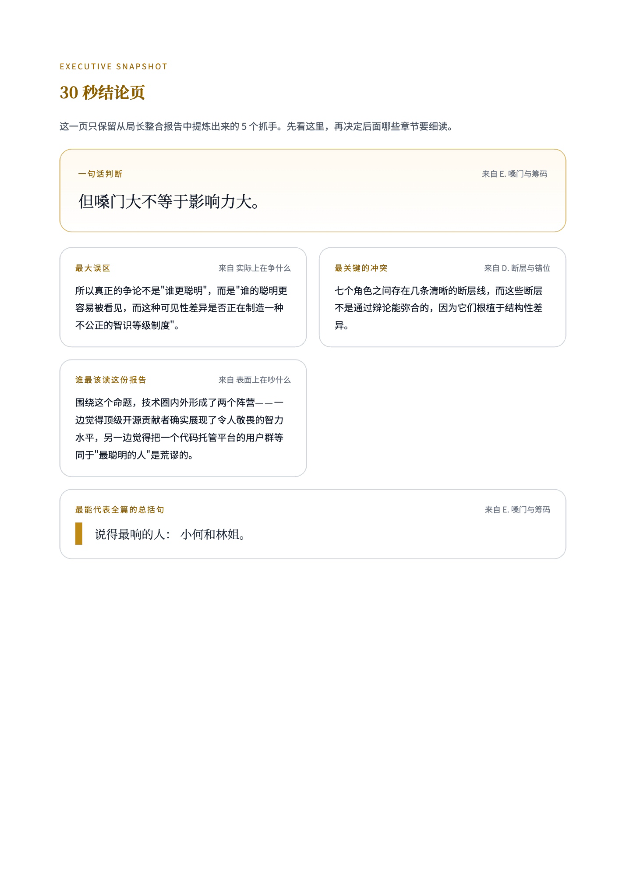
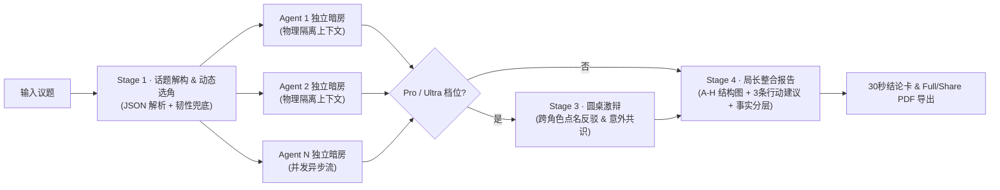

# 推演局 · Dynamic Cognitive Orchestrator

[](pyproject.toml)
[](main.py)
[](docs/architecture.md)
[](tuiyanju/demo.py)
[](LICENSE)

> **没有任何一种视角是绝对正确的。**

**推演局（Dynamic Cognitive Orchestrator）** 是一台把「单一争议问题」拆解为「多方处境图、隔离暗房独白、圆桌正面激辩与结构化决策报告」的**真·多 Agent 认知推演终端**。

它不是普通的 AI 聊天框，也不靠单条 Prompt 让同一个上下文分饰多角“左右互搏”——在默认的 **真·多 Agent 并发隔离模式** 下，每位角色都在**物理隔离的独立上下文窗口**中并发推演，彼此听不见、不串味，再经圆桌碰撞，最后由“推演局长”收敛出一份可快速扫描、可归档、可转发的正式报告。



---

## 核心特性

- **真·物理上下文隔离并发编排**：Stage 2 通过 `asyncio` 并发调度独立 LLM 会话，每位 Agent 仅接收议题与自身利益/盲点/声纹画像（`voice_profile`），从根源杜绝后发言角色隐式参考前文。
- **三种执行引擎自由切换**：
  - **真·多Agent并发隔离 (`multi_agent`)**：4 阶段完整编排，深度还原多方真实博弈。
  - **极速单流推演 (`single_stream`)**：单次流式生成，适合低 Token 快速探索。
  - **内置离线演示 (`demo` / 自动兜底)**：未配置 API Key 时自动无感切换，克隆仓库即可零成本体验完整 UI、并发暗房卡片、圆桌气泡与 PDF/MD/TXT 导出。
- **丝滑实时阅读体验**：80ms 流式渲染节流（`scheduleRender`）+ `<details>` 折叠状态跨帧保持 + 宽容标题匹配器，边流式生成边翻阅章节不卡顿、不重置折叠态，随时支持 `AbortController` 一键中止推演（后端同步检测断连并取消上游协程，停止消耗 Token）。
- **成品级多格式导出**：内置 **30 秒摘要卡**、声量×筹码 2×2 权力矩阵，支持导出 **完整归档版 PDF (`full`)**、**社交传播版 PDF (`share`)**、**结构化 Markdown (`.md`)** 与 **排版纯文本 (`.txt`)**。
- **契约化评测闭环**：提供 `schemas/analysis.json` 结构契约、10 组基准测试集（`evals/cases.jsonl`）、100 分制评分量表（`evals/rubric.md`）与可执行评测器 `evals/runner.py`。

---

## 架构数据流（True Multi-Agent Orchestration）



详细协议规范与模块设计请参阅 [docs/architecture.md](docs/architecture.md)。

---

## 三种运行模式对比

| 模式 | 参数值 | API 调用次数 | 上下文隔离度 | 推荐场景 |
|------|--------|-------------|-------------|----------|
| **真·多Agent并发隔离** | `multi_agent` | `1 (选角) + N (并发暗房) + 0/1 (圆桌) + 1 (局长)` | **物理级隔离**（零串味） | 深度议题拆解、战略复盘、高质量正式报告 |
| **极速单流推演** | `single_stream` | `1` 次流式请求 | 提示词逻辑隔离 | 快速头脑风暴、低延迟/低 Token 预算场景 |
| **内置离线演示** | `demo`（无 Key 自动触发） | `0`（本地异步流引擎） | 独立声纹模板 | 零配置开箱体验、UI 交互预览、导出链路联调 |

---

## 快速开始（Quick Start）

> **零配置即刻运行**：即使暂未准备大模型 API Key，直接启动服务并打开 `http://127.0.0.1:8000` 也可立即体验完整的离线多 Agent 推演与导出能力。

### macOS / Linux

```bash
git clone https://github.com/Johnson-Durui/tuiyanju.git
cd tuiyanju

python3 -m venv .venv
source .venv/bin/activate
pip install -r requirements.txt

# 可选：配置真实 OpenAI 兼容 API Key（不配也可直接运行离线演示模式）
cp .env.example .env

uvicorn main:app --host 127.0.0.1 --port 8000
```

### Windows (PowerShell)

```powershell
git clone https://github.com/Johnson-Durui/tuiyanju.git
cd tuiyanju

python -m venv .venv
.\.venv\Scripts\Activate.ps1
pip install -r requirements.txt

# 可选：复制并填写 .env（不配置时自动启用内置离线演示模式）
Copy-Item .env.example .env

python -m uvicorn main:app --host 127.0.0.1 --port 8000
```

启动后直接在浏览器访问（FastAPI 已直接托管前端与静态资源，彻底告别 `file://` 跨域问题）：

- **推演局主终端**：`http://127.0.0.1:8000`
- **健康检查与模式状态**：`http://127.0.0.1:8000/api/health`
- **交互式 API 文档**：`http://127.0.0.1:8000/api/docs`

---

## 双模式导出与演示样例

### 真实导出样例预览

仓库内置了一份完整生成的演示报告，可直接查看成品版式：

- [《github 上的人是否是最聪明的》完整报告 PDF](docs/demo/github-smartest-report.pdf)
- [正式报告封面预览图](docs/demo/github-smartest-report-cover.png)
- [30 秒结论页预览图](docs/demo/github-smartest-report-summary.png)

### `full` 完整归档版 vs `share` 社交传播版

| 导出模式 | 目标场景 | 包含章节结构 |
|----------|---------|--------------|
| **`full`（完整版 PDF）** | 深度阅读、团队内参、复盘归档 | 封面与系统元信息 → 30 秒结论页 → 目录与模块清单 → 推演轨迹 → 选角总览 → 全部暗房独白 → 圆桌激辩 → 局长 A-H 整合报告与行动建议 |
| **`share`（传播版 PDF）** | 社群转发、高管速览、要点对齐 | 封面 → 30 秒结论页 → 压缩版选角表 → 暗房金句卡片 → 圆桌交锋高光 → 局长核心洞察 → 3 条可落地行动建议 |
| **`.md` / `.txt` 导出** | 二次编辑、导入知识库（Obsidian / Notion） | 支持纯净正式报告导出，或附带 `【推演过程提示】` 轨迹导出 |

---

## API 与评测工具链

### 核心 HTTP / SSE 接口

- `POST /api/analyze`：发起流式推演（支持 `orchestration_mode`: `"multi_agent"` | `"single_stream"` | `"demo"`，`depth`: `"quick"` | `"standard"` | `"pro"` | `"ultra"`，`active_modules`: `["winners", "timeline", "signal", "action", "monitor", "appendix"]`）。
- `GET /api/health`：返回服务状态、支持的编排模式及 API Key 就绪状态。
- `GET /api/models`：拉取上游可用模型列表（离线时返回推荐模型清单）。
- `GET /api/modules`：返回 6 大增强透镜模块定义。

### 评测运行器 (`evals/runner.py`)

```bash
# 1. 离线校验 schemas/analysis.json、evals/cases.jsonl 与 100 分制 rubric.md
python evals/runner.py --mode validate

# 2. 跑通离线 SSE 全链路结构完整度评测
python evals/runner.py --mode demo-eval --limit 5

# 3. 使用真实 API Key 运行多 Agent 推演 + LLM 裁判按 8 维度打分并输出报告
python evals/runner.py --mode live --limit 3 --model gpt-4o-mini --output evals/reports/latest.json
```

### 运行自动化测试与代码检查

```bash
pytest
ruff check .
node tests/test_export_utils.js
```

---

## 目录结构速览

- [main.py](main.py) / [tuiyanju/](tuiyanju/)：FastAPI 入口与异步多 Agent 编排核心包
- [index.html](index.html) / [theme.css](theme.css) / [export_utils.js](export_utils.js)：推演局前端阅读器与多模式导出引擎
- [prompts/](prompts/)：系统提示词、动态选角、单人隔离暗房、圆桌激辩与局长整合提示词模板
- [schemas/analysis.json](schemas/analysis.json)：结构化输出 JSON Schema
- [evals/](evals/)：基准评测用例、评分标准与自动化评测 CLI
- [docs/architecture.md](docs/architecture.md) / [docs/visual-direction.md](docs/visual-direction.md)：系统架构设计与黑金终端视觉规范

---

## License

本项目采用 [MIT License](LICENSE) 开源许可协议。
