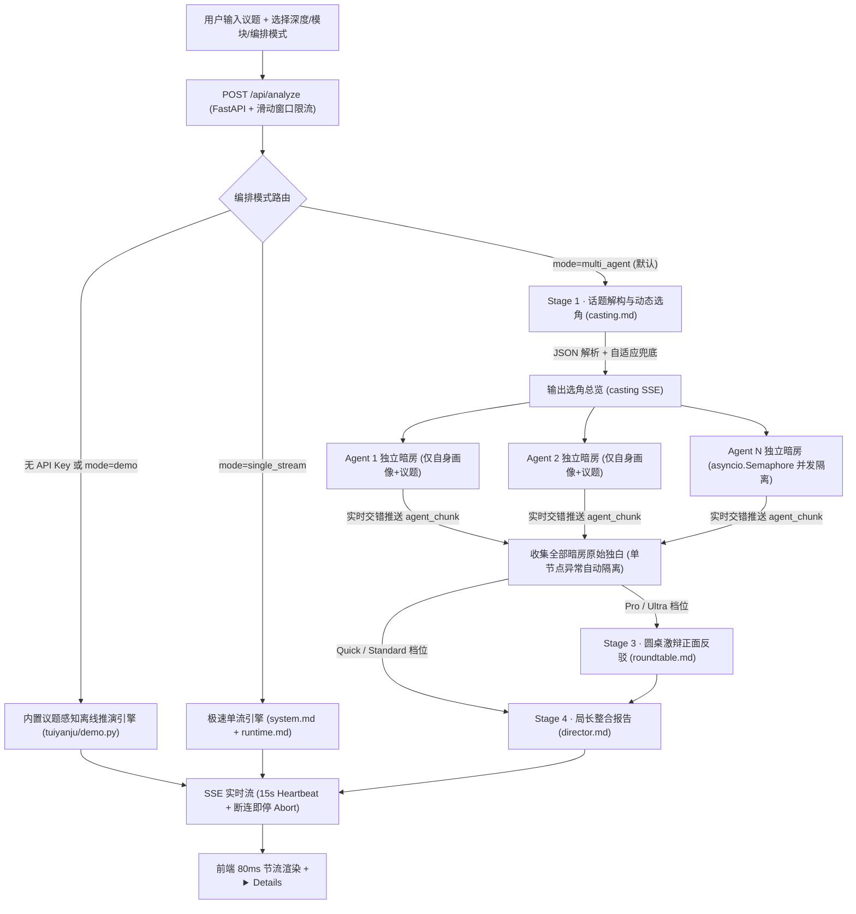

# 推演局 · 系统架构设计文档 (Architecture v2.0)

> **核心命题**：复杂议题不存在单一上帝视角。只有先在物理隔离的上下文里还原真实利益与认知盲点，再经正面碰撞与结构收敛，才能拼出可决策的立体真相。

---

## 1. 模块化目录拓扑

```text
tuiyanju/
├── main.py                     # FastAPI 兼容入口（支持 `uvicorn main:app` 一键启动与静态托管）
├── tuiyanju/                   # 核心后端 Python 包
│   ├── __init__.py             # 包版本与核心公共符号导出
│   ├── config.py               # 环境变量、安全 CORS 源、模型目录、默认声纹画像与限流参数
│   ├── models.py               # Pydantic 请求契约、动态 Token 预算、选角归一化与 JSON Schema 校验器
│   ├── prompts.py              # 模块化提示词加载器与多阶段模板渲染（含单 Agent 物理隔离系统提示词）
│   ├── orchestrator.py         # 全异步 httpx.AsyncClient 编排引擎（Multi-Agent / Single-Stream / Demo）
│   ├── demo.py                 # 零 API Key 议题感知离线推演引擎（支持自动无感降级）
│   └── rate_limit.py           # 单 IP 滑动时间窗限流器（防刷防额度耗尽）
├── prompts/                    # 提示词真源目录（禁止在 Python 内硬编码业务提示词）
│   ├── system.md               # 全局原则、深度分档规格与跨档位四条质量红线
│   ├── runtime.md              # 运行时动态参数注入模板
│   ├── casting.md              # Stage 1 话题解构与动态选角 JSON 生成约束
│   ├── agent.md                # Stage 2 单人独立暗房第一人称发言约束
│   ├── roundtable.md           # Stage 3 圆桌激辩正面交锋约束（Pro / Ultra 开启）
│   └── director.md             # Stage 4 局长 A-H 结构整合、行动建议与事实/推断/情绪分层
├── schemas/
│   └── analysis.json           # 结构化推演产物 JSON Schema 契约
├── evals/
│   ├── cases.jsonl             # 10 组跨领域基准测试议题（科技冲击、代际、组织、商业、政策等）
│   ├── rubric.md               # 8 维度 100 分制质量评分标准
│   └── runner.py               # 离线 Schema/数据集校验与自动化 LLM 裁判评测 CLI
├── index.html                  # 黑金战略阅读终端前端（无构建依赖原生 HTML/JS）
├── theme.css                   # 视觉 Token、响应式阅读骨架与打印样式表
├── export_utils.js             # 30 秒摘要提炼、章节折叠规则与 TXT / Markdown / PDF (Full & Share) 导出核心
├── docs/                       # 架构文档、视觉规范与真实 PDF 演示样例
└── tests/                      # Pytest 后端/编排/评测测试集 + Node.js 前端导出与脚本语法测试
```

---

## 2. 三种无缝执行模式

`/api/analyze` 支持三种编排引擎模式，兼顾深度质量、响应速度与开箱零配置体验：

| 维度 | `multi_agent`（真·多Agent并发隔离） | `single_stream`（极速单流推演） | `demo`（内置离线演示 / 自动兜底） |
|------|-----------------------------------|--------------------------------|----------------------------------|
| **隔离等级** | **物理级上下文隔离**（每位 Agent 独立请求，互不可见） | 逻辑级提示词隔离（单次上下文窗口完成全流程） | 物理隔离事件流仿真（完整复刻多阶段并发 SSE） |
| **执行拓扑** | `选角 (1)` + `并发暗房 (N)` + `圆桌 (0/1)` + `局长 (1)` | 单次流式生成 | 本地确定性议题感知多阶段并发流 |
| **串味风险** | **零串味**（Stage 2 请求不含其他角色姓名或观点） | 受模型长上下文注意力影响 | 独立声纹模板隔离生成 |
| **API Key 依赖** | 需要（未配置时默认无感降级至 `demo`） | 需要（未配置时无感降级至单流演示） | **零依赖**（克隆仓库即可完整运行与导出） |
| **适用场景** | 正式研究、战略复盘、深度选题、高仿真多方博弈 | 快速灵感验证、低 Token 预算探索 | 本地体验 UI、验证 PDF/MD 导出、离线演示与自动化测试 |

---

## 3. 真·多 Agent 并发隔离数据流



---

## 4. SSE 流式事件协议

所有 `/api/analyze` 响应均采用 `text/event-stream`，每帧格式为 `data: <JSON>\n\n`：

| `type` | 触发阶段 | 核心字段 | 说明 |
|--------|---------|----------|------|
| `mode_resolved` | 启动时 | `mode`, `auto_fallback` | 告知前端实际生效的编排引擎及是否触发无 Key 自动降级 |
| `status` | 全流程 | `label` | 面向用户的可见战术进度回放 |
| `heartbeat` | 静默超过 15s | - | 保持反向代理、CDN 与长耗时推理模型连接不断开 |
| `casting` | Stage 1 完成 | `issue_type`, `conflict_axes`, `topic_deconstruction`, `agents` | 驱动前端渲染选角总览与上场阵容 |
| `agent_start` | Stage 2 并发启动 | `agent` | 初始化对应角色的独立暗房卡片 |
| `agent_status` | Stage 2 推理/重试 | `agent_id`, `label` | 更新单个 Agent 的实时思考或续写状态 |
| `agent_chunk` | Stage 2 流式输出 | `agent_id`, `content` | 按 `agent_id` 精确路由的多路并发独白增量 |
| `agent_done` / `agent_error` | Stage 2 单卡结束 | `agent_id`, `content?` | 标记单角色完成或局部隔离异常 |
| `roundtable_start` / `roundtable_chunk` / `roundtable_done` | Stage 3 | `content?` | Pro / Ultra 档位圆桌交锋流 |
| `director_start` / `director_chunk` / `director_done` | Stage 4 | `content?` | 局长结构化整合报告流 |
| `chunk` | `single_stream` | `content` | 极速单流模式下的完整 Markdown 增量 |
| `error` | 异常终止 | `content` | 可读错误诊断信息 |
| `done` | 正常结束 | - | 触发前端最终排版收敛、30秒摘要提炼与导出栏解锁 |

---

## 5. 可靠性与工程加固要点

1. **全异步流与客户端断连即停**：全面采用 `httpx.AsyncClient` 与异步生成器，各阶段循环与流读取持续检测 `await request.is_disconnected()`；前端点击「中止推演」（`AbortController.abort()`）或关闭标签页时，后端立即 `cancel()` 所有并发暗房协程，杜绝后台空跑浪费额度。
2. **动态 Token 预算与截断续写**：`compute_max_tokens` 按深度（`quick` → `ultra/flagship`）、激活增强模块数、角色数与背景长度动态伸缩（旗舰档 `12,800–16,000`），避免硬编码小上限导致腰斩，同时在 `finish_reason == "length"` 时自动无痕续写。
3. **选角 JSON 韧性兜底**：`extract_json_object` 自动剥离代码块并修复尾随逗号；若上游模型偶发返回非标准文本，`parse_or_fallback_casting` 自动启用议题感知冲突阵容兜底，保证多阶段流水线不中断。
4. **前端 80ms 渲染节流与折叠状态保持**：高频 SSE 分片通过 80ms `scheduleRender` 合并更新，并在每次 DOM 刷新前后通过 `captureContainerFoldState` / `restoreContainerFoldState` 完整保留 `<details>` 与手风琴卡片的开合状态，实现边生成边顺滑阅读。
5. **安全边界与频率保护**：内置 `SlidingWindowRateLimiter` 按客户端 IP 执行滑动窗口限流（返回标准 `429` 与 `Retry-After` 头），CORS 默认收敛至本地可信源并支持通过 `CORS_ORIGINS` 环境变量按需配置。
6. **契约化评测闭环**：`evals/runner.py` 将 `schemas/analysis.json`、`evals/cases.jsonl` 与 `evals/rubric.md` 串联为可执行流水线，支持纯离线结构校验与在线 LLM 裁判自动打分。
